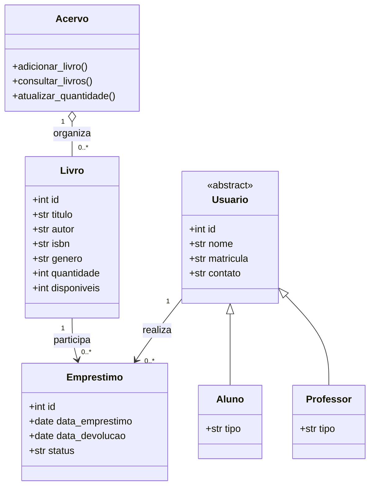

# Diagrama de Classes — Biblioteca Escolar Luz do Saber

## Relacionamentos
- `Usuario` é uma classe abstrata. `Aluno` e `Professor` herdam dela.
- Um livro pode aparecer em vários empréstimos ao longo do tempo.
- Um usuário pode realizar vários empréstimos.
- O acervo organiza vários livros.
